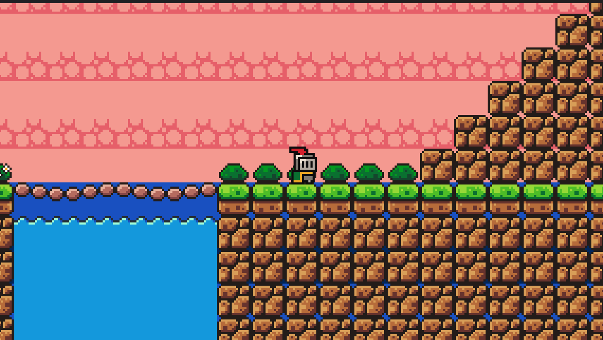

# Adventure

A 2D pixel platformer made with **Godot 4.7** and **GDScript**. Guide a little knight across the world, collect coins, and avoid the slimes and the water.

## Play the game

- **Windows:** download the latest build from the [Releases](../../releases) page, unzip it, and run `Adventure.exe`.
- **Browser:** play it on itch.io (add your link here).

## How to play

- Run and jump across the platforms.
- Collect as many coins as you can.
- Avoid the slimes. They patrol between two walls and pause at each end, so time your jump.
- Don't fall into the water. It restarts the level.

## Controls

| Action | Key |
|---|---|
| Move left / right | Arrow keys (or A / D) |
| Jump | Space (or Up arrow) |

## Features

- Player movement with running and jumping animations
- Slime enemies that walk between two walls and stop at each end
- Collectable coins with sound effects
- Kill zones in water, pits and on slimes that restart the level
- Layered tile world (Background and Mid layers) with palm trees and decorations

## Screenshots

| | |
|---|---|
|  |  |
|  |  |

## Project structure

- `scenes/` - game, player, platform, coin, killzone and slime scenes
- `scripts/` - GDScript files for the player, coin, killzone and slime
- `assets/` - sprites and sounds
- `screenshots/` - images used in this README

## Run it from source

1. Install [Godot 4.7](https://godotengine.org/download).
2. Clone this repository.
3. Open Godot, click **Import**, and select the `project.godot` file.
4. Press **F5** to run the game.

## Built with

- Godot Engine 4.7.2
- GDScript

## Credits

- Game made by YOUR NAME
- Pixel art and sound assets: add the creator's name and link here

## Feedback

Found a bug or have an idea? Open an **Issue** on this repository. Thanks for playing!
